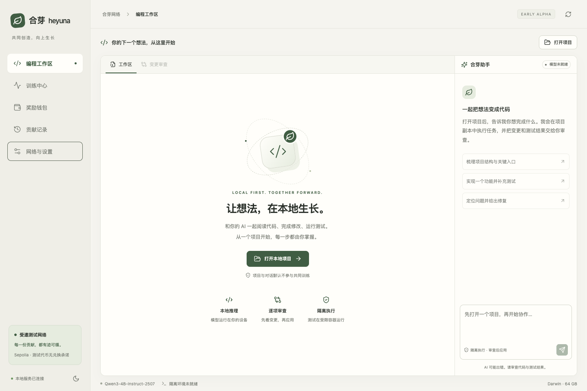

# 合芽 Heyuna

**让个人设备参与共同微调，让每份有效贡献可追溯。**

Heyuna is an open-source, invited-testnet alpha: a local coding workspace, opt-in FFA-LoRA workers, a contribution coordinator and fixed-supply reward contracts. It is not a launched currency or a production security claim.



## What is here

- `apps/desktop`: Tauri 2 + Rust + React/TypeScript + Monaco, five original views, local-only API bridge.
- `backend/heyuna`: local model runtime, constrained coding agent, project-copy/review/revert flow, training and contribution protocols.
- `contracts`: immutable ERC-20 supply, capped reward vault, delayed public fund, ABI and executable EVM tests.
- `services`: coordinator deployment and sandbox image.
- `docs`: architecture, training protocol, security boundaries, reward rules, evidence and release gates.

**Current evidence, exact limitations and outstanding gates: [verification](docs/verification.md).** UI screenshots are real local previews. Automated fixtures and local EVM results do not prove independent participants, Windows GPU operation, model quality gains or Sepolia transactions.

## Development

Requirements: Python 3.12, Node 22+, pnpm 11.25.0, Rust stable, platform Tauri prerequisites. For MLX use an Apple Silicon Mac; CUDA workers require a supported NVIDIA device. Model downloads need approximately 8 GB plus cache/training space. Never download weights from an unverified mirror.

```sh
python3 -m venv .venv
. .venv/bin/activate
python -m pip install uv==0.9.5
uv sync --frozen --extra mac --extra test
pnpm install --frozen-lockfile
pnpm desktop dev
```

Use `--extra cuda` instead of `--extra mac` on a supported Windows NVIDIA device. Tauri development locates the repository virtual environment and starts its own loopback service with an ephemeral token. A local macOS application bundle with embedded Python/MLX is implemented and has been launched; Developer ID signing, notarization and Windows installer/device validation remain open. See [desktop development](apps/desktop/README.md).

To preview only the web interface with the local backend:

```sh
python scripts/dev.py
```

This generates a process-local token, starts localhost services, and opens no remote service. It requires installed dependencies. The localhost-only browser developer preview accepts an explicit project path; the desktop application requires the native folder picker. For pure API diagnostics use `heyuna doctor`.

Coding execution requires an explicitly prepared Docker engine and the sandbox image:

```sh
docker build -t heyuna-sandbox:0.1 services/sandbox
```

The app refuses code execution without it. A project copy is mounted into a non-root, network-disabled, resource-limited container. Originals change only after review/apply; conflicting external edits stop application. Small Python and JS/TS projects are the initial supported scope.

## Verification

```sh
python -m pytest -q
python scripts/security_scan.py
pnpm typecheck
pnpm test:desktop
pnpm build
pnpm -C contracts install --frozen-lockfile
pnpm -C contracts check
pnpm -C apps/wallet install --frozen-lockfile
pnpm -C apps/wallet check
```

Optional real model/validator execution is documented in [federation](docs/federation.md). Do not submit smoke fixtures as paid contributions. CI has no signing keys and does not deploy.

## Token rules

| Rule | Value |
|---|---|
| Test network | Ethereum Sepolia, chain ID 11155111 |
| Asset | tHEYUNA; identify by chain ID **and deployed address** |
| Supply | 20,000,000 tokens, 18 decimals, created once |
| Reward vault | 18,000,000; 520 initial weekly budgets; unused value remains reserved |
| Public fund | 2,000,000; multisignature authorization + seven-day delay |
| Founder allocation | 0 |
| Reward acceptance | Valid work only, no guaranteed income |

No mainnet address exists in this repository. Test tokens carry no promise of mainnet conversion or market value. Supply is separate from circulating/distributed balances. See [reward specification](docs/rewards.md).

## Privacy, ownership and licenses

Contribution is off by default. Coding projects and conversations are not uploaded as training data. Only versioned, reviewed training templates run; the coordinator cannot send executable code. Training workers never receive wallet keys. External-wallet signing, when enabled after deployment, remains a separate user action.

Original code: [Apache-2.0](LICENSE). Dependencies, Qwen weights and training datasets retain their own licenses; see [license ledger](docs/licenses.md) and [NOTICE](NOTICE). The name is a working brand pending trademark clearance. UI is original; no OKX brand assets or product source have been copied.

Read [SECURITY](SECURITY.md), [CONTRIBUTING](CONTRIBUTING.md), [architecture](docs/architecture.md), [threat model](docs/threat-model.md), [whitepaper](docs/whitepaper.md), and [roadmap](docs/roadmap.md) before operating a node.
