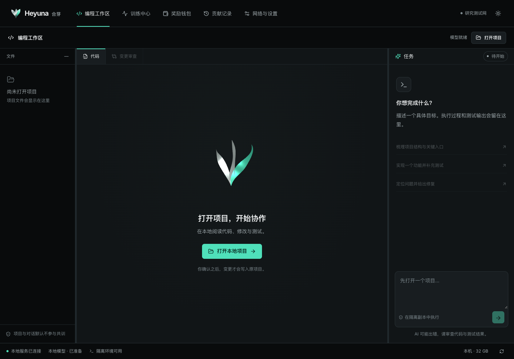

# 合芽 Heyuna 自主公链研究网

**独立 EVM 链，研究可信训练贡献验证。**

Heyuna builds its own `heyunad` node, genesis, native currency and invited validator network on a pinned Cosmos EVM / Cosmos SDK / CometBFT stack. Training and quality evaluation remain off chain. This is a **loopback research implementation**, not mainnet or a claim of security leadership.

- `chain/`: node, native supply/security rules, `x/contribution`, readonly EVM precompile.
- `contracts/`: native Merkle reward vault, 3/5 delayed public fund, deterministic CREATE2 bootstrap. Historical ERC-20 Alpha is explicitly separate.
- `backend/heyuna`: isolated coding assistant, opt-in fixed-template MLX/CUDA workers, versioned coordinator/protocols.
- `apps/desktop`, `apps/wallet`: original carbon/silver/teal UI, local fonts, focused motion and external-wallet signing.
- `research/`, `scripts/`, `docs/`: fault, contribution, economic and migration experiments, evidence and limitations.

Read [verification](docs/verification.md), [whitepaper](docs/whitepaper.md), [threat model](docs/threat-model.md), [EVM compatibility](docs/evm-compatibility.md). [Historical Alpha docs](docs/legacy-alpha/) retain the replaced Sepolia route. Old receipts never become native claim rights.



Interface preview uses test fixtures; it does not show live training or a verified balance. See [current UI checks](apps/desktop/evidence/brand-neutral-verification.json).

## Native currency

| Allocation | Genesis units |
|---|---:|
| Training and independent recomputation | 14,000,000 |
| Consensus security | 4,000,000 |
| Public fund | 2,000,000 |
| Fixed team allocation | 0 |

Genesis supply is **20,000,000 × 10¹⁸**. No periodic mint module exists. Committed supply cannot exceed its previous committed value, including after explicit protocol burns. SDK bank and EVM share balances. Research `tHEYUNA` has no promised value or mainnet conversion. See [economic rules](docs/rewards.md).

## Reproduce a local chain

Requirements: Python3.12, Node22+, pnpm11.25.0, official dependency downloads and platform build tools. The chain helper downloads **Go1.25.9** and verifies its official SHA256. Keys/databases stay in ignored `.state/`. RPCs and test keyrings must remain local.

```sh
sh scripts/chain_build.sh
python3 scripts/chain_localnet.py keys --profile research
pnpm -C contracts install --frozen-lockfile --ignore-scripts
node contracts/scripts/research-genesis.mjs .state/chain-research/public-accounts.json .state/chain-research/genesis-contracts-input.json "$(date +%s)"
python3 scripts/chain_localnet.py init --profile research --contracts .state/chain-research/genesis-contracts-input.json
python3 scripts/chain_localnet.py start --profile research
node contracts/scripts/research-deploy.mjs .state/chain-research
python3 scripts/chain_localnet.py audit --profile research
```

Normal profile: Cosmos `heyuna_297011-1`, EVM297011, EVM RPC9545, Comet27657, **72h challenge**, weekly subsidies. Explicit `accelerated` profile: separate chain297012, EVM RPC10545, Comet28657, **3s challenge and 3s security-subsidy epochs**. Contribution budgets stay weekly. Accelerated results do not prove72hours elapsed. Experimental chain IDs are not globally registered.

Genesis prefunds future immutable contract addresses. A genesis CREATE2 factory deploys reviewed init code there. The public-fund constructor transfers100,000 from its2m budget to a research faucet; remaining1.9m requires3/5 plus7days. Zero-fee bootstrap resolves the initial deployment-gas cycle. Public fee economics remain a separate gate.

```sh
python3 scripts/chain_localnet.py faults --profile accelerated
sh scripts/chain_go.sh test ./app ./x/contribution ./precompiles/contribution
python3 scripts/chain_localnet.py stop --profile research
```

Scripts refuse to overwrite initialized networks or stop unrelated processes. Stop nodes before replacing binaries. See [operations](docs/researchnet-operations.md).

## Desktop development

```sh
python3 -m venv .venv
. .venv/bin/activate
python -m pip install uv==0.9.5
uv sync --frozen --extra mac --extra test
pnpm install --frozen-lockfile
pnpm desktop dev
```

Use the separately reviewed `cuda` extra on supported Windows NVIDIA hardware. Weights are a separate pinned download. Coding runs in a network-disabled, non-root container with a project copy; no sandbox means execution is refused. Changes require review/apply and support conflict-aware rollback. Contribution starts off. Projects/conversations are not training data. Model/executor/worker cannot sign wallet operations.

The original UI uses local Inter, Motion14.6.0 and lazy Three.js0.186.1. Three metallic ribbons form a sprout in idle scenes. Rendering is released on compute work, lost focus/visibility and reduced-motion/effects settings. See [design](docs/design.md).

## Checks and limits

```sh
python -m pytest -q
python scripts/security_scan.py
pnpm typecheck
pnpm test:desktop
pnpm build
pnpm -C contracts check
pnpm -C apps/wallet check
sh scripts/chain_go.sh test ./app ./x/contribution ./precompiles/contribution
```

Complete recomputation remains the default. Quorum signatures/Merkle proofs authenticate allocations, not training truth. Four local processes are one operator. Seven nodes with at least four independent operators, genuine heterogeneous GPU training, independent audits and sustained public operation remain separate gates. “Fifty years ahead” is a vision, never a measured result.

Online services are planned within¥1,000/month; engineering, independent devices/nodes and audits need separate resources. No paid service or mainnet has been deployed by these local scripts.

Own additions: [Apache-2.0](LICENSE). Dependencies/models/data/fonts retain their licenses: [ledger](docs/licenses.md), [NOTICE](NOTICE), [upstream](chain/upstream/SOURCE.md). The interface, text and motion are original. Heyuna is an independent project; no third-party affiliation or endorsement is implied. Heyuna is a working name pending trademark clearance.

## Native iPhone and Mac wallet (development preview)

The independent [Apple wallet](apps/apple-wallet/README.md) adds BTC/Signet and ETH/Sepolia
native-coin accounts, local recovery backup, receive QR codes, explicit transaction review,
and system-authenticated local signing. It shares no seed or signing permission with the
coding assistant or training client. The Heyuna research network remains disabled until its
trusted manifest integration is implemented. Current code is a development preview;
[release gates](apps/apple-wallet/APP_STORE.md) distinguish local tests and archives from
physical-device verification and App Store publication. The current individual developer
membership does not satisfy Apple's organization requirement for wallet distribution.
