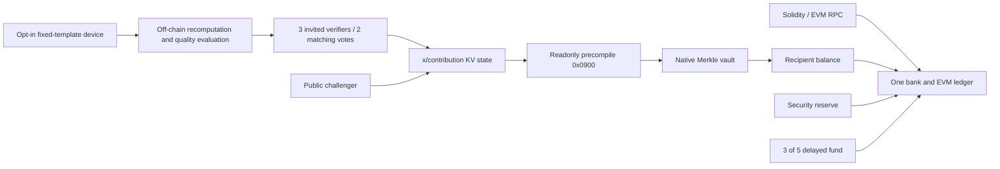

# Sovereign researchnet architecture

`heyunad` derives from the Apache2 Cosmos EVM example v0.7.3, with its complete dependency lock: Go1.25.9,SDK0.54.3,CometBFT0.39.3 and Cosmos geth replacement. No new consensus or cryptographic algorithm is claimed. Original attribution is in`chain/upstream/`.

Consensus executes bounded protobuf/JSON authentication, domain checks, hashes, integer budgets and KV transitions. Models, floating-point evaluation and downloads remain off chain. Signers attest reports; they do not cryptographically establish report truth.

`chain/app/app.go` wires the EVM/SDK/Comet modules with contribution and research-security modules. `research_policy.go` removes inflation and restricts message types. Dynamic validator/delegation admission, authz tunnels, governance writes, IBC transfer and unrelated native write precompiles are closed. Four equal genesis validators only. Standard SDK reward withdrawals retain ownership checks. All node/RPC listeners are loopback.

`research_module.go` owns reserve schedule and finalized-participation payment state. EndBlock compares committed supply with the prior committed value. State persists across restart/export; a burn cannot be reversed by refilling to the original20m cap. Upstream VM internal reconciliation permissions remain, constrained by the end-of-block invariant.

Contribution CLI/protobuf/state/precompile details are in[`chain/x/contribution/README.md`](../chain/x/contribution/README.md). Its internal protobuf version1 is a different namespace from application bundle version2. Neither gives legacy Alpha rights.

## Initialization and identity

Research297011 has72h challenges; separate accelerated297012 has3s challenges/security epochs. Contribution budgets are weekly in both. IDs are experimental, not publicly registered.

V2 manifest binds canonical Cosmos GenesisDoc SHA256, network domain, EVM block1 hash, native units and contract code/addresses. SDK AppGenesis is converted to actual Comet GenesisDoc before hashing; live`/genesis`is compared. File SHA256 is separate build evidence. Genesis cannot embed its own full hash without circularity. Wallet verifies canonical genesis, its own provider's EVM anchor, runtime hashes and readonly oracle pointer. Initial trusted manifest distribution remains a root of trust.

Genesis prefunds predicted reward/fund addresses. Fixed CREATE2 factory0x0F01 deploys init code committed by those addresses; alternate code changes the address. Any relayer may deploy the correct code. Managers/faucet are explicit constructor values, never relayer identity. No deployer receives all20m first.

## Client and evolution

Renderer→constrained Rust bridge→per-launch pinnedTLS loopback service. Executor uses a network-disabled non-root project-copy container; workers run as separate credential-scrubbed processes. Only the external wallet signs. Projects/conversations are not shared training data.

Legacy schemas stay explicit; native ones are`protocol/*.v2.schema.json`. Tasks bind network, recipient, model/tokenizer, data, sharedA/baseB, config and round. OnlyLoRA B trains. Coordinator DB cannot silently switch network/protocol. Category1 recomputation work has its own accepted receipt; signatures alone earn nothing.

Future upgrades require reviewed new binary/migration. Supply non-increase, finalized rights and bank/EVM equality must survive dual-binary historical replay and interruption. Current same-version replay/crash recovery is a baseline, not a cross-version upgrade proof. Offline ML-DSA experiments do not replace SDK accounts, consensus, P2P or update-verifier signatures.

PostgreSQL is intended for coordinator deployment; SQLite is local test storage. Online-service budget excludes independent operators, devices, engineering and audits.
