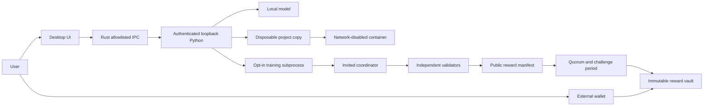

> Historical v0.1 Alpha. Superseded by the sovereign researchnet; not native-chain policy or current evidence.

# Architecture v0.1

## Trust boundaries

The alpha still trusts the task coordinator for scheduling and an explicitly configured validator set for acceptance. The chain enforces reward accounting, signatures and delay, not truth of computation. A Merkle proof proves membership in a published allocation, not that a model improved.

## Local execution

React renders plain text for untrusted model/repository output; Monaco is loaded locally. Rust creates a random local API token, keeps it out of the renderer, launches the bundled Python service (repository environment in development), and restricts IPC methods/paths. Each managed launch creates a new loopback TLS identity; the Rust client trusts only that certificate, with no system roots, proxy, redirect or plaintext fallback. This prevents a port-squatting service receiving tokens or project request bodies. Local API requests are authenticated, Origin-checked, bounded and non-cacheable. Explicit browser development uses localhost HTTP and a server-side bearer proxy; it is not a production server.

The coding agent has five tools: list files, read file, write file, run container tests, finish. It has no wallet, arbitrary host shell, network, secret store, or coordinator admin tool. It works on bounded UTF-8 text projects. Secret-like paths and symbolic links are excluded. User application of a change checks current originals against the snapshot and rejects conflicts; revert uses the same guard. This is not a hardened defense against an already compromised same-user host or filesystem races by a malicious local process.

The container receives only the disposable workspace. Network is disabled; root filesystem read-only; UID is non-root; capabilities removed; privilege escalation disabled; CPU, memory, process count and runtime are bounded. A fixed, non-dumpable namespace PID 1 enforces a maximum 120-second deadline even if the desktop/backend dies; application shutdown also removes its active containers. Controllers sample workspace size (64 MiB / 4,000 entries) and log output; this is not a kernel disk quota and transient overshoot is possible. Special files such as FIFOs are rejected without blocking. Docker runtime/image readiness is required. Never fall back to executing generated programs on the host. Download/build phases require network separately and are not model tools.

## Model and training

The pinned upstream checkpoint is `Qwen/Qwen3-4B-Instruct-2507` at revision `cdbee75f17c01a7cc42f958dc650907174af0554`. No remote Python code loading. The first template trains rank-8 B matrices only, in q/v projections of the last two model layers; A is shared, hashed and frozen. MLX and PyTorch layouts are converted at the serialization boundary. This deliberately small template is an interoperability experiment, not proof of broad model-quality improvement.

Inference and training compete for one device resource lock. A running training subprocess can be terminated; stop must prevent submission. Settings gate task windows, process memory and upload allowance. CPU percentage is monitored, not an OS-enforced training quota. A portable GPU hard quota is not claimed.

## Contribution data model

The authoritative closed schemas are in `backend/heyuna/protocol.py`. `TrainingTask` binds model/tokenizer revision, data, shared A, initial B, template, configuration and work units. `ContributionReceipt` carries submitted artifact identity, verification state and reason. `RewardEpoch` records accepted allocation and budget. Unknown fields are rejected.

Coordinator: FastAPI, SQLAlchemy, SQLite for deterministic local tests; PostgreSQL for deployment. Small adapter artifacts use bounded, hash-verified JSON database records in the alpha. A production S3 adapter and independent availability replication are not implied by this storage implementation. Invitations and worker/validator/admin permissions are distinct. Repeated result submissions are idempotent. Leases expire and can be reassigned. Duplicate validation or reward issuance is rejected.

Accepted work is not automatically claimable: publication, quorum signature, challenge interval, finalization and wallet transaction are separate states. No HTTP endpoint may silently label an allocation on-chain confirmed. Contract events and canonical chain receipts are required for that transition.

## Chain and wallet

Three functional contracts: `HeyunaToken`, `RewardVault`, `PublicFund`; an atomic testnet factory deploys/binds them. OpenZeppelin primitives supply standard ERC-20/signature/Merkle behavior. ABI is checked in. Deployments use a separate manifest; no address is fabricated in an unconfigured UI. Wallet key custody is outside the local service. `apps/wallet` supplies a separate EIP-1193 claim portal, with optional OKX provider selection, fixed claim calldata and canonical receipt checks. Its controls stay unavailable until a reviewed real deployment manifest verifies against the selected chain; local contract tests do not enable financial controls.

Contract upgrades require explicit new deployments. No proxy can replace the token rules. Mainnet requires a new reviewed release and independent signers, with an explicit migration/adoption decision.
