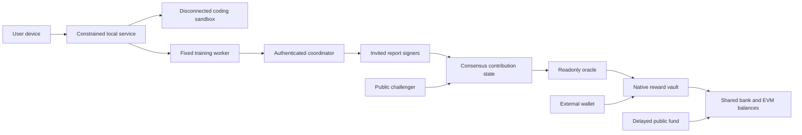

# Heyuna researchnet threat model

## Executive summary

Scope is the local sovereign research implementation, desktop/worker/coordinator, node and native settlement, plus separate development/release tooling. The most consequential residual risks are validator/verifier collusion, upstream EVM/SDK defects, compromised user devices and trusted-manifest distribution. A2/3training-verifier quorum can authorize false reports within monetary caps. Four local consensus processes are one operator. No independent audit or public decentralized-security conclusion is established.

## Scope and validated assumptions

User-approved scope: invited researchnet, independent consensus/verification roles, no mainnet/value promise, no bridges/public staking, opt-in public training data, external wallet, loopback initial deployment, online budget≤¥1000 excluding engineering/nodes/devices/audit. These were explicitly specified in the implementation request, not inferred production requirements. Real operator independence, dataset representativeness, future public transport and production key custody remain unvalidated. A root/admin-compromised device can defeat same-user isolation; container/driver/kernel trust is not eliminated.

Runtime evidence anchors: `chain/app/research_policy.go::researchAnteHandler,enforceSupplyCap`; `chain/app/research_module.go`; `chain/x/contribution/keeper.go`; `chain/precompiles/contribution/precompile.go`; `contracts/src/NativeRewardVault.sol`; `NativePublicFund.sol`; `backend/heyuna/network.py::_run`; `coordinator.py::create_coordinator_app`; `apps/wallet/src/nativeWallet.ts`. Tests/examples are not runtime authority. CI and release scripts are a separate supply-chain boundary.

## System model

Trust boundaries: project→model/tool proposals; renderer→Rust/API; coordinator→fixed worker; artifact→verifier; report signer→consensus; oracle→Solidity/native transfer; untrusted manifest→wallet network handshake; build dependencies→distributable. The chain never executes training Python/floats/downloads. Genesis uses explicit prefunded CREATE2 destinations; EVM/bank reconciliation is checked after block hooks.

## Assets and attacker model

Assets: capped native supply, finalized roots and claim bitmaps, fund/security balances, consensus safety/availability, correct contribution attribution, private project/data, wallet/signing keys, release/source integrity and user consent/resource limits. Attackers may submit arbitrary tasks/results/reports/challenges/contracts/calldata, operate many accounts, compromise coordinator/renderer/dependencies, steal individual keys, withhold data, replay messages or collude up to/over quorum. They do not automatically control host root or independent keys. The current local test operator actually controls all test identities; this is disclosed rather than treated as adversarial independence.

## Entry points

| Entry | Attacker-controlled material | Concrete boundary |
|---|---|---|
| Local API/Rust bridge | Project paths/actions/request bodies | `backend/heyuna/app.py`, `projects.py`, `sandbox.py`; bounded/authenticated origin/host, constrained commands |
| Coordinator HTTP | Credentials, task bundles, artifacts, verdicts | `coordinator.py::BodyLimit,Principal`, closed v1/v2 schemas, DB network lock |
| Worker | Data/tensor/model metadata | `training.py::validate_dataset,verify_model_files`; safetensors and fixed template |
| SDK transaction | Protobuf sender and bounded JSON envelope | `chain/x/contribution/types.go`, `keeper.go`; domain/role/state/nonces/budgets |
| EVM RPC/contract | EVM tx/calldata/value/gas | Upstream keeper plus `precompile.go`, immutable native contracts |
| Wallet import/provider | Deployment/bundle JSON, EIP1193 replies | `nativeProtocol.ts`, `nativeWallet.ts`; identity/code/proof/finality/receipt checks |
| Build/release | Dependency source/actions/scripts | Pinned locks/action commits, secret scanning, provenance; no CI deployment keys |

## Top abuse paths

1. Colluding verifiers sign a false computation report→valid quorum→capped false allocation. Chain cannot determine ML truth; independent recomputation, heldout studies and real verifier independence are still required.
2. Malicious update passes finite/norm checks while poisoning quality→quality gate fails to detect it. Hash/proof integrity does not establish usefulness. Preserve complete recomputation and independent heldout acceptance; sampling must meet preregistered gates.
3. Copy/frontrun an unverified result hash→occupy dedup key→deny honest contribution. Dedup must occur at accepted reward reservation; unaccepted candidates cannot reserve global rights. Separately bind recomputation work to a real accepted target and evidence, because identical recomputed B is expected.
4. Exploit native/EVM reconciliation, refund or post-fee accounting→net inflation or overpayment. Shared bank ledger, previous-supply bound, per-tx escrow and same-height balance audits are critical, but do not prove upstream code bug-free.
5. Steal one verifier key→freeze pending batches indefinitely; steal quorum→false acceptance/cancel. Availability recovery needs real independent roles and published key policy; finalized roots remain immutable.
6. Malicious renderer/prompt/data→host command or wallet access. Closed model tools and disconnected project-copy container limit execution; wallet capability is absent from model/worker. Host compromise still breaks guarantees.
7. Substitute same chain ID with another genesis/RPC/code→misdirect claim. Trusted canonical genesis+EVM anchor+code/oracle identity checks and exact recipients constrain it; initial manifest trust remains.
8. Dependency/release compromise→malicious signed software. Lockfiles/scans are partial controls; signed reproducible artifacts, full license/SBOM and independent review remain separate distribution gates.

## Threat register

| ID | Threat / consequence | Likelihood / impact / priority | Implemented controls and evidence | Residual requirement |
|---|---|---|---|---|
| TM-001 | Verifier quorum collusion pays false work | High / High / P1 | Domain,2/3,challenge/freeze and budget caps in contribution keeper/native vault | Independent signers, funded monitoring, public evidence; not solvable by Merkle proof |
| TM-002 | EVM/refund/supply synchronization inflation | Medium / Critical / P1 | EndBlock previous supply bound; bank/EVM ledger audit, native caps, tests | Independent chain/VM review, adversarial boundary fuzzing |
| TM-003 | Copy/replay/frontrun contribution and duplicate reward | High / High / P1 | Task/result/recipient/domain binding, accepted-work reservation, bitmap, fresh nonces | Actual independent compute attribution remains statistical/trust-based |
| TM-004 | Final root overwrite or admin fund theft | Medium / High / P1 | Immutable finalized state; no native vault owner/drain;3/5fund and7days | Independent manager control, recovery/migration policy |
| TM-005 | Coordinator sends executable code/private model data | High / High / P1 | Fixed template, pinned files, offline loading, finite tensor bounds, no wallet env | Driver/dependency vulnerabilities, data provenance/gradient privacy |
| TM-006 | Model/renderer crosses host or wallet boundary | Medium / Critical / P1 | Restricted Rust/API methods, TLS pinning, no host fallback, container project copy | Sandbox escape/Windows ACL/device penetration tests |
| TM-007 | Same-chain-ID counterfeit network | Medium / High / P1 | Canonical genesis,own-provider block1 anchor,runtime hashes,proof/receipt checks | Trusted manifest distribution, compromised provider threat |
| TM-008 | Key theft freezes pending rewards or stalls chain | High / High / P1 | Pending-only freeze; no user transfer freeze;4-node fault/restart test | Real independent operators, key rotation, monitoring |
| TM-009 | DoS by calldata/results/challenges/RPC | High / Medium / P2 | Payload/entry/proof limits, metered readonly oracle, explicit errors, loopback | Public rate limits, validator resource-cost benchmarks |
| TM-010 | Training leaks data or steals user resources | Medium / High / P1 | Opt-in, no project/conversation upload, schedules/RSS/upload limits, cancel | No differential privacy/secure aggregation claim; process limits not OS GPU quotas |
| TM-011 | Upgrade breaks supply/final rights | Medium / Critical / P1 | Same-version appHash replay/crash baseline, export state, immutable contracts | Actual dual-version migration and rollback review still open |
| TM-012 | Unfunded long-term validator security | High / High / P1 | Separate reserve/fee accounting;520/1040/2600 cost scenarios | No fixed return or security lifetime; independent economic attacks/public operation |
| TM-013 | PQ claim hides remaining classical surfaces | Medium / High / P2 | Offline ML-DSA roles and explicit nonintegration | Real accounts/consensus/P2P/update migration, cost/interop/side-channel work |
| TM-014 | Dependency or release compromise | Medium / Critical / P1 | Locks, retained upstream provenance, secret CI, source attestations | Independent audit, signed binaries, patch compatibility review |

Likelihood reflects current invited local mode; public exposure materially raises TM-007/009/014. Priority is engineering review urgency, not a claim that an exploitable defect is confirmed in every row. Critical assets are monetary invariants, finalized rights and host/wallet authority; tests only cover stated assumptions.

## Focus for security review

1. `research_policy.go`, fee PostHandler and module ordering: no hidden inflation, per-tx fee isolation, correct revert/refund behavior.
2. Contribution keeper: reservation atomicity, target/report/dedup binding, cancellation release, week/nonces, immutable finality, bounded data growth.
3. Native vault/public fund: exact-leaf interpretation, category budgets, native external-call behavior, EIP712/CREATE2 constructor domains.
4. Wallet native parser/provider lifecycle and worker/coordinator receipt checks: reject protocol/network/category/target mismatch, do not display remote assertions as chain payment.
5. Local sandbox/secret isolation, cross-platform file races/ACLs, packaged runtime provenance.

## Notes and open gates

No claim of full bytecode formal verification: Z3 proves stated integer arithmetic obligations, not implementation refinement. Static source policy is not Slither. Fault tests do not emulate arbitrary Byzantine equivocators. Same-version replay is not cross-version migration. Source CI, local app build, actual-device GPU results, signed distribution and public network operation remain distinct evidence. Mainnet requires two independent audits/remediation review, no unresolved critical/high issues, real signer/operator independence, economic/consensus attack testing and sustained public evidence.
